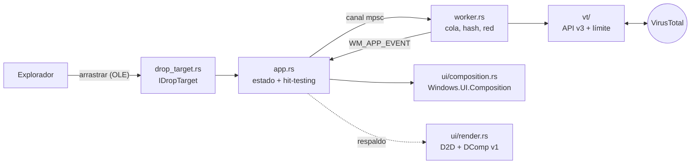
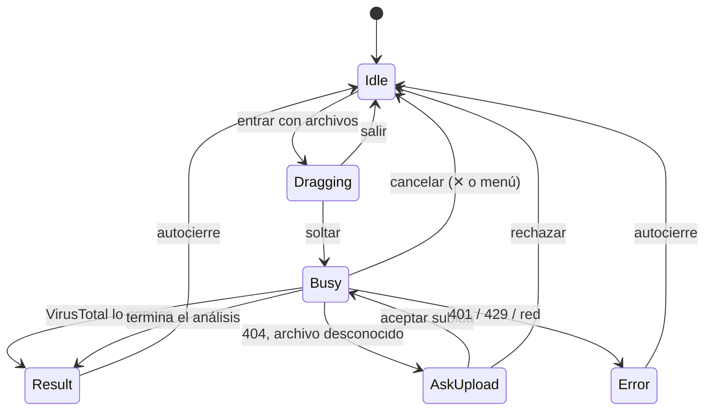

# VTDrop

**Arrastra un archivo sobre el círculo. VirusTotal te dice si es seguro.**

Widget flotante para Windows 10/11: sin instalador, sin servicios, sin privilegios de administrador. Un solo `.exe` de 1.6 MiB.

*A tiny floating Windows widget that scans dropped files with VirusTotal.*

[](https://github.com/undaniel/vt-drop/actions/workflows/ci.yml)
[](LICENSE)
[](#requisitos)
[](Cargo.toml)
[](#rendimiento)


VTDrop calcula el SHA-256 del archivo, consulta el informe y transforma el círculo en una cápsula con el ratio de detecciones. Un clic abre el informe en el navegador. Si VirusTotal no conoce el archivo, pregunta antes de subirlo.

## Requisitos

- Windows 10 2004 (build 19041) o Windows 11, x64.
- Una API key gratuita de [VirusTotal](https://www.virustotal.com/gui/my-apikey) (4 peticiones por minuto en el plan público).

## Instalación

No hay instalador: descarga `vtdrop.exe` de la última [release](https://github.com/undaniel/vt-drop/releases) y ejecútalo desde donde quieras. El binario no está firmado, así que SmartScreen puede pedir confirmación la primera vez (*Más información → Ejecutar de todas formas*).

Cada tag `v*` publica automáticamente un `.zip` con el ejecutable, el README y la licencia. Para compilarlo tú mismo, ver [Compilar](#compilar).

## Uso

| Acción | Resultado |
|---|---|
| Arrastrar archivos sobre el círculo | Los analiza. Varios a la vez y también durante un escaneo |
| Clic en la cápsula | Abre `virustotal.com/gui/file/<sha256>` |
| Clic en el ✕ (aparece con el mouse encima mientras escanea) | Cancela el hash y la subida en el acto |
| Clic derecho | Menú contextual nativo: *Siempre encima*, *Iniciar con Windows*, *Configurar API key…*, *Abrir último resultado*, *Salir* |
| Arrastrar el círculo | Mueve el widget y guarda la posición |
| `vtdrop.exe <archivo>…` | Analiza esos archivos al arrancar (útil para *Abrir con*) |
| Mouse encima | Tooltip con el paso actual o el detalle del error |

En el primer arranque, VTDrop pide la API key en un diálogo nativo. Se guarda cifrada con DPAPI en `%APPDATA%\VTDrop\config`; nunca se escribe en el JSON, en logs ni en la línea de comandos.

## Características

- **Forma propia.** El círculo se convierte en cápsula sobre `Windows.UI.Composition`: el recorte es un `CompositionGeometricClip` y el fondo un `CreateHostBackdropBrush`, con acrílico real en Windows 11 si las transparencias están activas. DWM no añade borde ni esquinas.
- **Motion Fluent.** Curva de WinUI `cubic-bezier(0,0,0,1)`, 250 ms al expandir y 167 ms al colapsar. Las animaciones las ejecuta DWM en su hilo, a la frecuencia real del monitor, aunque la UI esté ocupada con el menú. En reposo no hay timers ni hilos de animación.
- **Una redimensión por transición.** La ventana toma su tamaño final una sola vez; después solo se animan visuales, sin `SetWindowPos`.
- **Lotes.** Suelta archivos en cualquier momento: en reposo, con un resultado visible o mientras escanea. Durante un escaneo se suman al lote y el contador crece al instante (`1/2`, `2/3`…).
- **Progreso real.** `42%` al calcular el hash (archivos ≥ 16 MB) y al subir; tiempo transcurrido (`1:05`) mientras VirusTotal analiza, porque ahí no existe un porcentaje.
- **El resultado no se pierde.** La cápsula solo se cierra tras `auto_close_secs` de uso real del PC y con el mouse fuera. Si el análisis termina mientras no estás, sigue ahí al volver.
- **VirusTotal con modales.** Ventana deslizante de peticiones (conservada entre lotes), reintento respetando `Retry-After`, sondeo cada 15 s durante 10 min y rechazo de archivos de más de 650 MB antes de subirlos.
- **Integración con Windows.** Tema claro/oscuro con cambio en caliente, color de acento, DPI PerMonitorV2, respeto a "Efectos de animación", instancia única, inicio con Windows y toasts de resumen.

## Configuración

`%APPDATA%\VTDrop\config.json`:

```json
{
  "position": [1832, 944],
  "always_on_top": true,
  "threshold_amber": 1,
  "threshold_red": 4,
  "auto_close_secs": 8,
  "auto_upload": false,
  "scan_folders": false,
  "requests_per_minute": 4,
  "version": 1
}
```

| Clave | Por defecto | Qué hace |
|---|---|---|
| `position` | — | Esquina superior izquierda física del círculo; se ajusta al área de trabajo del monitor |
| `always_on_top` | `true` | Mantiene el widget sobre las demás ventanas |
| `threshold_amber` / `threshold_red` | `1` / `4` | Detecciones que pintan la cápsula de ámbar y de rojo (0 → verde) |
| `auto_close_secs` | `8` | Segundos de uso del PC antes de cerrar el resultado; `0` lo mantiene abierto |
| `auto_upload` | `false` | Evita la pregunta de subida (opt-in explícito) |
| `scan_folders` | `false` | Recorre carpetas soltadas en lugar de ignorarlas |
| `requests_per_minute` | `4` | 1–60. El plan público de VirusTotal permite 4 |

Un `config.json` antiguo que incluya `backdrop` sigue cargando: esa opción y la tecla F9 se eliminaron cuando el widget pasó a dibujar su propia forma.

## Compilar

Requiere Rust 1.80 o superior. No hay dependencias que compilar fuera del ecosistema de Rust: `rustls`, `windows`, `serde` y poco más.

```powershell
cargo build --release
.\target\release\vtdrop.exe
```

**GNU (sin administrador):** instala `stable-x86_64-pc-windows-gnu` con rustup y WinLibs (GCC + binutils + `windres`) en el `PATH`.

**MSVC:** instala Visual Studio Build Tools con "Desarrollo para el escritorio con C++" y el Windows SDK, y usa `stable-x86_64-pc-windows-msvc`.

`build.rs` incrusta el icono y el manifiesto con `embed-resource`. MinGW-W64 14 enlaza siempre su propio manifiesto `longPathAware` y descarta cualquier otro con el mismo id, así que en GNU el manifiesto de la app se embebe como `RT_MANIFEST/2` y se activa al arrancar (`ui/styles.rs`) para tener Common Controls v6 y el tema real de los controles. En MSVC viaja como `RT_MANIFEST/1` y no hace falta nada más.

El perfil de release usa `opt-level="z"`, LTO, `codegen-units=1`, `strip=true`, `panic="abort"` e `incremental=false`.

## Arquitectura



```
main.rs / lib.rs      WinMain, mutex de instancia, COM/OLE, argumentos, message loop
app.rs                máquina de estados UI, transiciones, hit-testing, menú, cancelación
ui/window.rs          DWM: sin marco ni bordes, tema, topmost, DPI, host backdrop
ui/composition.rs     Windows.UI.Composition: círculo/cápsula, acrílico, animaciones, superficies D2D
ui/render.rs          respaldo: D3D11 (WARP) + DXGI + DComposition + D2D/DWrite
ui/animation.rs       curva Fluent, anillo WinUI, FrameClock solo para el respaldo
ui/menu.rs            menú contextual nativo (HMENU + TrackPopupMenu)
ui/styles.rs          Common Controls v6 en la build GNU (tema real de los controles)
ui/tooltip.rs         tooltip propio (GDI) con fundido de entrada
drop_target.rs        IDropTarget OLE (CF_HDROP) + fallback WM_DROPFILES
worker.rs             hilo único: cola, hash, consultas, subida, sondeo, cancelación
vt/mod.rs             cliente VT API v3 (rustls), ventana deslizante, reintento 429
hash.rs               SHA-256 en streaming (buffer de 1 MB) con progreso y corte
config/               JSON atómico + DPAPI + diálogo nativo de API key
toast.rs              toast WinRT con AUMID y acceso directo en Inicio
```

### Máquina de estados



Un drop durante `Busy` o `AskUpload` se suma al lote; un drop en `Result` o `Error` empieza un lote nuevo.

La UI nunca bloquea: el worker es dueño de la cola y de la red. La comunicación worker→UI es una cola `Mutex<VecDeque>` + `PostMessage(WM_APP_EVENT)`; la UI→worker usa un canal `mpsc`. La cancelación viaja como bandera atómica (para cortar el hash o la subida en el acto) y además como mensaje por el canal, de modo que todo lo que llegue antes de ese mensaje pertenece al lote cancelado y se descarta.

### Render y DPI

El backend principal es `Windows.UI.Composition`. La ventana tiene un `DesktopWindowTarget` y un árbol de visuales que DWM dibuja y anima; cada texto (ratio, porcentaje, tiempo, avisos, botones, badge) vive en un `CompositionDrawingSurface` que solo se redibuja cuando cambia su contenido. Las coordenadas van en píxeles físicos y las superficies se crean a `DPI / 96`, así que el texto queda nítido a cualquier escala; al cambiar de monitor se recrea el renderer.

En Windows 10 2004+ funciona el mismo backend con fondo sólido. El acrílico requiere Windows 11 y transparencias activas. Si `CreateDesktopWindowTarget` falla, `ui/mod.rs` cae al renderer antiguo (D3D11 WARP + DirectComposition v1 + Direct2D) sin cambiar nada más. Para forzarlo:

```powershell
$env:VTDROP_RENDERER = "legacy"
```

Detalles y desviaciones en [MIGRACION_COMPOSITION.md](MIGRACION_COMPOSITION.md).

## Rendimiento

Medido en Windows 11 26300 (x64, 1920×1080 al 100 %, iGPU Intel, WARP), con el renderer de respaldo. La medición del backend de composición está pendiente:

| Métrica | Valor |
|---|---|
| `vtdrop.exe` release | **1.61 MiB** (1 689 088 bytes) |
| Working set en reposo | **~0.3–0.4 MB** tras el trim |
| Private bytes en frío | **~7.2 MB** |
| Private bytes tras un escaneo | **~14–17 MB** (TLS y WinRT cargados) |
| Working set con un resultado visible | ~40 MB (superficies), vuelve a < 1 MB al cerrarse |
| CPU en reposo | **0 ms** en 10 s, también con un resultado visible |
| CPU de un escaneo conocido | ~0.1 s en total (arranque, hash, consulta y expansión) |

El renderer de respaldo prefiere WARP porque el driver de la GPU añadía por sí solo decenas de MB de memoria privada en esta máquina. El backend de composición usa el dispositivo de hardware: `CreateGraphicsDevice` comparte el mismo `ID2D1Device` que dibuja las superficies de texto.

## Pruebas

39 pruebas unitarias, ejecutadas en CI sobre MSVC para cada push y pull request; la build GNU (MinGW) se compila y prueba en el mismo workflow.

```powershell
cargo build            # las pruebas leen el .exe real para sus recursos
cargo test
```

Cubren hash EICAR, estadísticas, configuración, curvas de animación, continuidad del anillo, geometría del compositor (círculo → cápsula, ancla, glyph), banderas del menú, recursos del diálogo, activación de Common Controls v6, límite de peticiones, cola del lote y cancelación. Hay dos pruebas que crean objetos reales: un `DesktopWindowTarget` con tres frames dibujados y el diálogo nativo desde su plantilla. La primera se omite en CI porque el runner no tiene un escritorio con DWM.

Prueba en vivo contra la API (solo consulta, no sube nada). Usa `VT_API_KEY` o la clave DPAPI que haya guardado la app:

```powershell
$env:VT_API_KEY = "..."
cargo test --test live_vt -- --ignored --nocapture
cargo run --release --example vt_probe -- <sha256>
```

## Seguridad y privacidad

- Manifiesto `asInvoker`: no pide elevación. Ejecutarlo elevado rompería el drag & drop desde el Explorador por UIPI.
- La API key se cifra con `CryptProtectData` (DPAPI, entropía propia) y no se registra nunca.
- En las consultas solo se envía el SHA-256. La subida, solo tras confirmarla, envía el archivo completo y lo hace visible a otros usuarios de VirusTotal.
- HTTP con rustls, sin telemetría propia.
- Instancia única por mutex local: una segunda ejecución trae al frente la existente.

## Decisiones y límites

<details>
<summary>Por qué el menú y el diálogo son nativos de Win32</summary>

El menú contextual es `HMENU` + `TrackPopupMenu` (`ui/menu.rs`) y el diálogo de la API key es un recurso `DIALOGEX` con `STATIC`/`EDIT`/`BUTTON` reales (`assets/vtdrop.rc`, `config/key_dialog.rs`). Antes ambos se dibujaban a mano con DirectComposition para imitar el estilo Fluent.

El motivo del cambio: el menú redondeado del Explorador es XAML/WinUI y no existe forma de pedirlo a un `HMENU`, así que la imitación costaba ~2 000 líneas y nunca coincidía del todo con la tipografía y el comportamiento del sistema. Ahora el teclado, el lector de pantalla, el modo oscuro y el ajuste a los bordes de pantalla los pone Windows. El precio es el aspecto clásico, sin iconos.

La build GNU, además, se quedaba sin Common Controls v6 porque el linker descartaba el manifiesto: los controles se dibujaban como en Windows 2000. `ui/styles.rs` activa el manifiesto embebido con `CreateActCtxW` antes de crear ventanas.
</details>

<details>
<summary>Diferencias con la especificación original</summary>

- El acrílico real dentro del círculo solo existe en Windows 11 con transparencias; en Windows 10 queda el color sólido del tema (DWM solo ofrece acrílico rectangular).
- La expansión usa la curva Fluent en vez de un rebote tipo spring.
- Tras subir un archivo, el análisis se revisa cada 15 s en lugar de con backoff exponencial.
- Se eliminaron la opción `backdrop` y la tecla F9.
- Se añadieron cancelar, progreso y soltar durante el escaneo, que se pidieron después.
</details>

**Pendiente:** alto contraste, navegación por teclado del widget y soporte del Narrador.

## Licencia

MIT. Ver [LICENSE](LICENSE).
